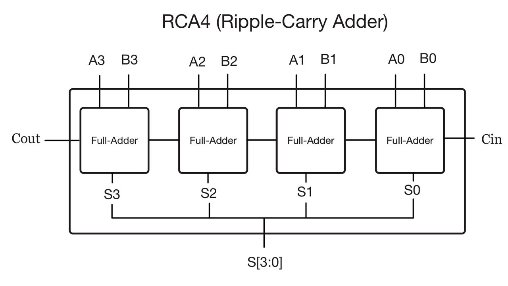
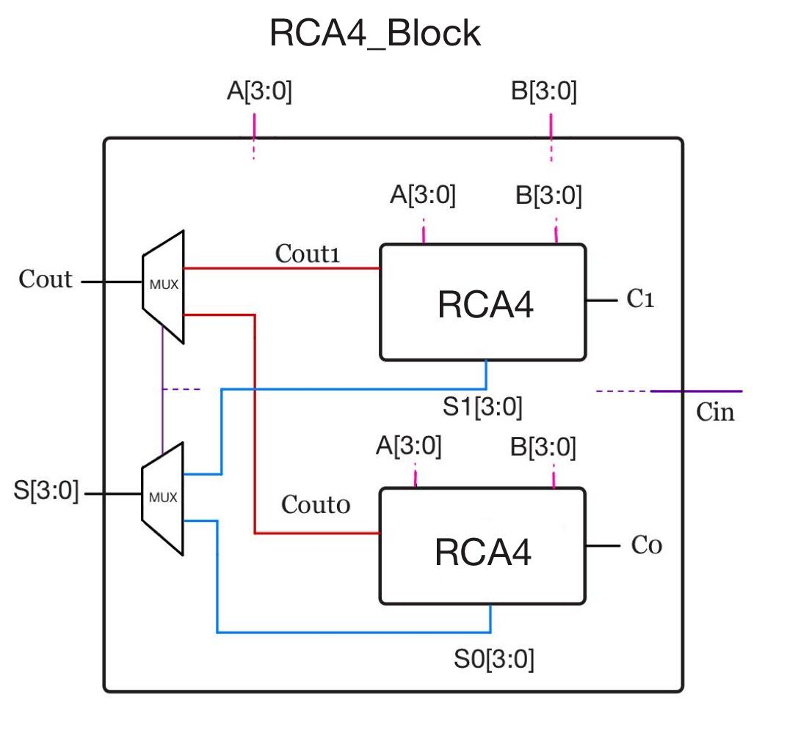
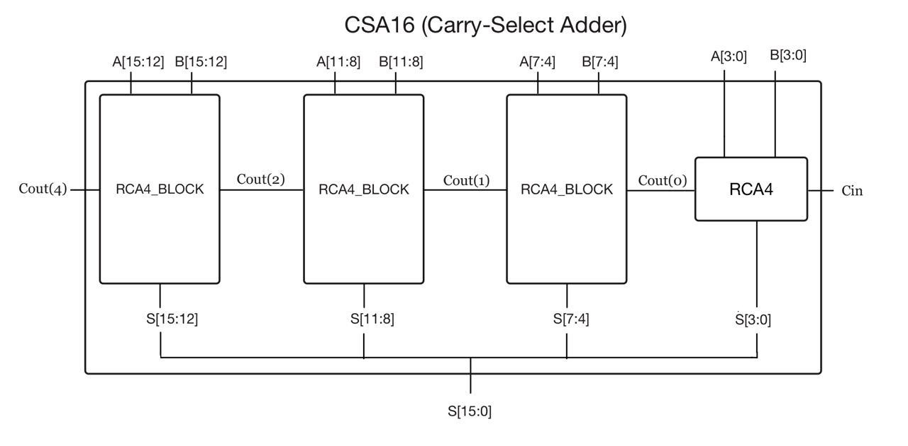
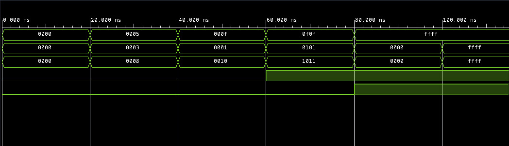

# Relazione del primo progetto di Elettronica Digitale

di Francescantonio S., Gabriel A. P., Cosmo S.
Ottobre 2026,

Di seguito verranno trattati brevemente la teoria alla base degli adder, VHDL e nel dettaglio il processo di realizzazione di un CSA a 16 bit proposto come traccia per il primo progetto del corso di Elettronica Digitale (LT Ing. Informatica, Dimes, Unical, docente Stefania Perri).

# Introduzione

## I circuiti sommatori

I sommatori, o adder in inglese, sono un tipo di elemento circuitale fondamentale nei sistemi digitali, poiché responsabili di operazioni matematiche chiave come la somma, sottrazione (tramite Complemento a Due), moltiplicazione e divisione hardware, incremento. 
Sono presenti ad esempio in circuiti combinatori come le ALU (Arithmetic Logic Unit), in unità dedicate per operazioni specifiche di supporto come l'incremento del Program Counter o il calcolo degli indirizzi nelle Unità di Generazione degli Indirizzi (AGU - Address Generation Unit) per l'accesso alla memoria, o ancora sono presenti massicciamente nelle GPU per gestire i calcoli geometrici, vettoriali e di rendering 3D.
Data la loro importanza, nel corso degli anni sono state proposte diverse soluzioni circuitali per minimizzare il ritardo combinatorio, da cui dipende la massima frequenza operativa in un sistema sincrono.

Il circuito fondamentale alla base dei sommatori più complessi è il Full-Adder, che si occupa di sommare tre bit, ovvero la coppia di bit A e B e il riporto in ingresso Cin (Carry-in), e produce due output, il risultato della somma S e il riporto in uscita Cout (Carry-out).

Una possibile soluzione è il Ripple-Carry Adder (RCA), che esegue la somma di due numeri in notazione binaria, sommando bit a bit, dalla coppia meno significativa a quella più significativa, procedendo verso sinistra, propagando di volta in volta il riporto, in modo analogo all'addizione in colonna che gli umani svolgono a mano. Questo metodo gode del vantaggio della semplicità implementativa, ma soffre dell'estrema lentezza causata proprio dalla propagazione del riporto.

Un'architettura più complessa e costosa, ma molto più veloce, è il Carry-Select Adder (CSA), che mira a parallelizzare il calcolo ignorando in un primo momento il riporto, che solo alla fine dell'operazione servirà per riportare il risultato corretto. L'idea è quella di dividere gli n bit da sommare in p blocchi da m bit, secondo la relazione n = p * m. Il primo blocco è composto da un RCA, mentre i blocchi  dal secondo all'ultimo sono composti da due RCA che eseguono in parallelo la somma dei medesimi bit, uno con il segnale Cin = 1 e l'altro con Cin = 0. Il risultato verrà selezionato da un multiplexer, che riceverà come segnale di selezione il riporto del blocco precedente. 

## VHDL e Vivado

Il VHDL (acronimo di VHSIC Hardware Description Language, dove "VHSIC" è la sigla per Very High Speed Integrated Circuits), è un linguaggio di descrizione dell'hardware, in grado di modellare il comportamento e la struttura di sistemi digitali a diversi livelli di astrazione, spaziando dal livello di sistema fino a quello delle porte logiche.

Vivado è un ambiente di sviluppo integrato sviluppato da AMD (in precedenza da Xilinx) per progettare, testare e programmare circuiti integrati programmabili, chiamati FPGA e SoC. La suite di Vivado permette di scrivere codice VHDL, simulare il comportamento del circuito e tradurre il codice descrittivo di alto livello in uno schema concreto di porte logiche elementari, multiplexer, registri e interconnessioni (sintesi del circuito).
# Progettazione

Per la realizzazione del CSA a 16 bit, dopo un primo confronto, supportato da strumenti tradizionali come la lavagna, si è giunti all'unanimità alla scelta di strutturare il progetto a moduli seguendo un approccio bottom-up, che sono stati sviluppati nei seguenti file VHDL:

- FullAdder.vhd
- RCA4.vhd
- RCA4_Block.vhd
- CSA16.vhd
- CSA16_tb.vhd

Per l'intero progetto si è fatto riferimento esclusivamente alla libreria standard IEEE (in particolare il package IEEE.STD_LOGIC_1164.ALL) e ai tipi primitivi BIT e BIT_VECTOR.
L'implementazione è affrontata nel dettaglio per ogni componente nei paragrafi successivi.

## FullAdder


Il Full-Adder è la base di ogni circuito sommatore. Esso prende gli ingressi in bit A, B e Cin e restituisce le uscite S e Cout, come dichiarato nelle porte dell'Entity

``` VHDL
    Port ( A, B  : in  bit;
           Cin   : in  bit;
           S     : out bit;
           Cout  : out bit );
```

ed esegue le operazioni di somma e riporto:

Somma
``` VHDL
S    <= (A xor B) xor Cin;
```

Riporto

``` VHDL
Cout <= (A and B) or (B and Cin) or (A and Cin);
```
  

L'implementazione completa in VHDL è la seguente:

``` VHDL
library IEEE;
use IEEE.STD_LOGIC_1164.ALL;

entity FullAdder is
    Port ( A, B  : in  bit;
           Cin   : in  bit;
           S     : out bit;
           Cout  : out bit );
end FullAdder;

architecture Behavioral of FullAdder is
begin
    S    <= (A xor B) xor Cin;
    Cout <= (A and B) or (B and Cin) or (A and Cin);
end Behavioral;

```
  

## RCA4

L'Entità RCA4 implementa un Ripple-Carry Adder a 4 bit ottenuto connettendo 4 istanze di FullAdder.


L'implementazione completa in VHDL è la seguente:

``` VHDL
library IEEE;
use IEEE.STD_LOGIC_1164.ALL;

entity RCA4 is
    Generic ( N : integer := 4 );
    Port ( A, B : in  bit_vector(N-1 downto 0);
           Cin  : in  bit;
           Cout : out bit;
           S    : out bit_vector(N-1 downto 0) );
end RCA4;

architecture Behavioral of RCA4 is
    signal c : bit_vector(N downto 0);

    component FullAdder is
        Port ( A, B  : in  bit;
               Cin   : in  bit;
               S     : out bit;
               Cout  : out bit );
    end component;
begin
    c(0) <= Cin;

    ciclo: for i in 0 to N-1 generate
        fa: FullAdder port map (
            A    => A(i),
            B    => B(i),
            Cin  => c(i),
            Cout => c(i+1),
            S    => S(i)
        );
    end generate;

    Cout <= c(N);
end Behavioral;

```

Schema logico di progettazione:




## RCA4_Block

Una volta creati i sommatori possiamo a configurare una struttura intermedia, che è stata aggiunta per semplificare l'implementazione del CSA.
Questo blocco è composto dai due sommatori RCA4, che ricevono in ingresso la stessa sequenza di bit A e B, e calcolano la somma in modo concorrente, uno con il bit di riporto Cin pari a 0 e l'altro con Cin pari a 1, simulando i possibili outcome del segnale di uscita di riporto Cout del blocco precedente. 
Sarà proprio questo segnale, una volta calcolato, a selezionare la somma corretta attraverso un multiplexer. La stessa cosa avviene per il carry bit in uscita, che allo stesso modo deve essere selezionato tra i due che vengono generati dai sommatori.
Nell'implementazione VHDL è stata attribuita a ogni blocco la gestione di 4 bit, e quindi l'Entità riceve in ingresso vettori a 4 bit nelle porte A e B e un bit Carry-in per decidere il risultato corretto, mentre restituisce in uscita il Carry-out, che si propaga nel blocco successivo e il vettore della somma effettiva. All'interno dell'architettura sono stati aggiunti dei segnali di supporto, due per rappresentare i possibili Carry-out e altri due per le somme, in modo tale da poterle leggere al momento opportuno, ovvero quando sarà pronto il Carry-in.

``` VHDL
entity RCA4_Block is
    Generic ( N : integer := 4 );
    Port ( A, B     : in  bit_vector(N-1 downto 0);
           Cin_sel  : in  bit;
           Cout_sel : out bit;
           S        : out bit_vector(N-1 downto 0) );
end RCA4_Block;
```

Sono mappati quindi due sommatori collegati agli stessi ingressi A e B, ma con Carry-in in ingresso diversi: il primo riceve 0, il secondo 1.

``` VHDL
    Sommatore1: RCA4
        generic map ( N => N )
        port map (
            A    => A,
            B    => B,
            Cin  => c0,
            S    => res0RCA,
            Cout => Cout0
        );

    Sommatore2: RCA4
        generic map ( N => N )
        port map (
            A    => A,
            B    => B,
            Cin  => c1,
            S    => res1RCA,
            Cout => Cout1
        );

    S        <= res0RCA when (Cin_sel = '0') else res1RCA;
    Cout_sel <= Cout0 when (Cin_sel = '0') else Cout1;
```

I multiplexer sono descritti dall'istruzione concorrente VHDL when else.


L'implementazione completa in VHDL è la seguente:

``` VHDL
library IEEE;
use IEEE.STD_LOGIC_1164.ALL;

entity RCA4_Block is
    Generic ( N : integer := 4 );
    Port ( A, B     : in  bit_vector(N-1 downto 0);
           Cin_sel  : in  bit;
           Cout_sel : out bit;
           S        : out bit_vector(N-1 downto 0) );
end RCA4_Block;

architecture Behavioral of RCA4_Block is
    signal res0RCA, res1RCA : bit_vector(N-1 downto 0);
    signal Cout0, Cout1     : bit;
    constant c0             : bit := '0';
    constant c1             : bit := '1';

    component RCA4 is
        Generic ( N : integer := 4 );
        Port ( A, B : in  bit_vector(N-1 downto 0);
               Cin  : in  bit;
               Cout : out bit;
               S    : out bit_vector(N-1 downto 0) );
    end component;
begin
    Sommatore1: RCA4
        generic map ( N => N )
        port map (
            A    => A,
            B    => B,
            Cin  => c0,
            S    => res0RCA,
            Cout => Cout0
        );

    Sommatore2: RCA4
        generic map ( N => N )
        port map (
            A    => A,
            B    => B,
            Cin  => c1,
            S    => res1RCA,
            Cout => Cout1
        );

    S        <= res0RCA when (Cin_sel = '0') else res1RCA;
    Cout_sel <= Cout0 when (Cin_sel = '0') else Cout1;
end Behavioral;

```

Schema logico di progettazione:




## CSA16

A questo punto tutti i pezzi sono pronti per essere assemblati nella struttura del sommatore CSA.
Questo prende in ingresso i vettori a 16 bit A e B e un Carry-in, restituendo in output il
vettore somma e il Carry-out.

``` VHDL
entity CSA16 is
    Port ( A, B  : in  bit_vector(15 downto 0);
           S     : out bit_vector(15 downto 0);
           Cin   : in  bit;
           Cout  : out bit );
end CSA16;
```

Una volta dichiarata l'Entity, è implementata l'Architettura come segue.
Il primo component RCA4 è semplicemente un sommatore di cui si conosce già il valore del carry-in in ingresso. Le porte A e B sono collegate ai 4 bit meno significativi e l'uscita a un vettore di supporto per trasportare i segnali di carry all'interno del sommatore. La somma a sua volta è collegata ai bit meno significativi.

``` VHDL
    somma0: RCA4
        generic map ( N => 4 )
        port map (
            A    => A(3 downto 0),
            B    => B(3 downto 0),
            Cin  => Cin,
            Cout => c_out(0),
            S    => S(3 downto 0)
        );
```

Ai moduli successivi sono collegati in ordine 4 bit per volta partendo dai meno significativi fino ai più significativi, attraverso un ciclo for che permette di semplificare la scrittura del codice ridondante. All'interno del ciclo sono collegati per ogni blocco sommatore anche il carry-in ricevuto dal precedente e il suo carry-out diretto al successivo. Infine è collegata l’uscita.

``` VHDL
    ciclo: for i in 1 to 3 generate
        blocco: RCA4_Block
            generic map ( N => 4 )
            port map (
                A        => A(((i+1)*4)-1 downto i*4),
                B        => B(((i+1)*4)-1 downto i*4),
                Cin_sel  => c_out(i-1),
                Cout_sel => c_out(i),
                S        => S(((i+1)*4)-1 downto i*4)
            );
    end generate;

    Cout <= c_out(3);
```


L'implementazione completa in VHDL è la seguente:

``` VHDL
library IEEE;
use IEEE.STD_LOGIC_1164.ALL;

entity CSA16 is
    Port ( A, B  : in  bit_vector(15 downto 0);
           S     : out bit_vector(15 downto 0);
           Cin   : in  bit;
           Cout  : out bit );
end CSA16;

architecture Behavioral of CSA16 is
    signal c_out : bit_vector(3 downto 0);

    component RCA4 is
        Generic ( N : integer := 4 );
        Port ( A, B : in  bit_vector(N-1 downto 0);
               Cin  : in  bit;
               Cout : out bit;
               S    : out bit_vector(N-1 downto 0) );
    end component;

    component RCA4_Block is
        Generic ( N : integer := 4 );
        Port ( A, B     : in  bit_vector(N-1 downto 0);
               Cin_sel  : in  bit;
               Cout_sel : out bit;
               S        : out bit_vector(N-1 downto 0) );
    end component;
begin
    somma0: RCA4
        generic map ( N => 4 )
        port map (
            A    => A(3 downto 0),
            B    => B(3 downto 0),
            Cin  => Cin,
            Cout => c_out(0),
            S    => S(3 downto 0)
        );

    ciclo: for i in 1 to 3 generate
        blocco: RCA4_Block
            generic map ( N => 4 )
            port map (
                A        => A(((i+1)*4)-1 downto i*4),
                B        => B(((i+1)*4)-1 downto i*4),
                Cin_sel  => c_out(i-1),
                Cout_sel => c_out(i),
                S        => S(((i+1)*4)-1 downto i*4)
            );
    end generate;

    Cout <= c_out(3);
end Behavioral;

```

Schema logico di progettazione:




# Simulazione

## CSA16_tb

Per verificare il corretto funzionamento del circuito, è stato implementato il file di testbench per la simulazione, che prevede la scrittura dell'Entità con il corpo vuoto, senza la dichiarazione di porte dato che non si sta aggiungendo nuovo hardware. 

``` VHDL
entity CSA16_tb is
end CSA16_tb;
```


La parte più importante e degna di nota è l'Architettura, che contiene al suo interno la dichiarazione del component CSA16 e le sue porte, i segnali di interconnessione S_A, S_B, S_S, S_Cin, S_Cout e il processo di stimolo "Psim", che definisce alcuni casi di test da verificare. In particolare vengono assegnati ai segnali di ingresso dei vettori a 16 bit, rappresentati in notazione esadecimale, e viene usata la funzione di "wait for 20 ns" per scandire il tempo tra un test e l'altro, e "wait" senza parametri per terminare la simulazione.

``` VHDL
    PSim: process
    begin
        S_A   <= x"0000";
        S_B   <= x"0000";
        S_Cin <= '0';
        wait for 20 ns;
```


L’ implementazione completa in VHDL è la seguente:

``` VHDL
library IEEE;
use IEEE.STD_LOGIC_1164.ALL;

entity CSA16_tb is
end CSA16_tb;

architecture Behavioral of CSA16_tb is
    component CSA16
        Port ( A, B  : in  bit_vector(15 downto 0);
               S     : out bit_vector(15 downto 0);
               Cin   : in  bit;
               Cout  : out bit );
    end component;

    signal S_A, S_B, S_S        : bit_vector(15 downto 0);
    signal S_Cin, S_Cout        : bit;
begin
    Simulazione: CSA16
        port map (
            A    => S_A,
            B    => S_B,
            S    => S_S,
            Cin  => S_Cin,
            Cout => S_Cout
        );

    PSim: process
    begin
        S_A   <= x"0000";
        S_B   <= x"0000";
        S_Cin <= '0';
        wait for 20 ns;

        S_A   <= x"0005";
        S_B   <= x"0003";
        S_Cin <= '0';
        wait for 20 ns;

        S_A   <= x"000F";
        S_B   <= x"0001";
        S_Cin <= '0';
        wait for 20 ns;

        S_A   <= x"0F0F";
        S_B   <= x"0101";
        S_Cin <= '1';
        wait for 20 ns;

        S_A   <= x"FFFF";
        S_B   <= x"0000";
        S_Cin <= '1';
        wait for 20 ns;

        S_A   <= x"FFFF";
        S_B   <= x"FFFF";
        S_Cin <= '1';
        wait;
    end process;
end Behavioral;

```


Visualizzazione dei segnali utilizzati nel testbench:



# Sintesi

# Conclusioni

